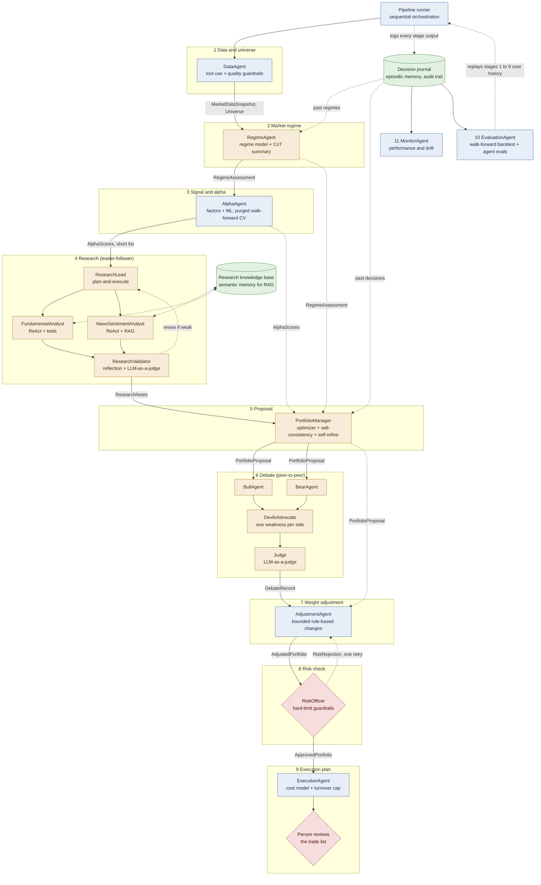

# Project Plan

This plan turns the brief in [CLAUDE.md](CLAUDE.md) into a sequence of pipeline stages and milestones. It covers stocks only.

Book abbreviations: `ml4t` is *Machine Learning for Algorithmic Trading* (Third Edition) and `baa4f` is *Building AI Agents for Finance*. Chapter numbers below were checked against the local copies of both books.

## Pipeline overview

Each stage is its own agent with one responsibility. Each stage reads earlier stages' typed outputs and writes one typed output, so it can be tested, replaced, or rerun on its own.

| # | Stage | Agent(s) | Kind | Main input | Main output |
|---|-------|----------|------|------------|-------------|
| 1 | Data and universe | `DataAgent` | Code | Run date, universe rules | `MarketDataSnapshot`, `Universe` |
| 2 | Market regime assessment | `RegimeAgent` | Model + LLM summary | `MarketDataSnapshot` | `RegimeAssessment` |
| 3 | Signal and alpha models | `AlphaAgent` | ML models | `MarketDataSnapshot`, `Universe`, `RegimeAssessment` | `AlphaScores` |
| 4 | Fundamental and news research | `ResearchLead` with `FundamentalAnalyst`, `NewsSentimentAnalyst`, `ResearchValidator` | LLM agents | Short list from `AlphaScores` | `ResearchNotes` |
| 5 | Stock and weight proposal | `PortfolioManager` | Optimizer + LLM | `RegimeAssessment`, `AlphaScores`, `ResearchNotes` | `PortfolioProposal` |
| 6 | Adversarial debate | `BullAgent`, `BearAgent`, `DevilsAdvocate`, `Judge` | LLM agents | `PortfolioProposal`, `ResearchNotes`, `RegimeAssessment` | `DebateRecord` |
| 7 | Weight adjustment | `AdjustmentAgent` | Rules + LLM rationale | `PortfolioProposal`, `DebateRecord` | `AdjustedPortfolio` |
| 8 | Risk check | `RiskOfficer` | Code | `AdjustedPortfolio`, `MarketDataSnapshot`, risk limits | `ApprovedPortfolio` or `RiskRejection` |
| 9 | Cost-aware execution plan | `ExecutionAgent` | Code | `ApprovedPortfolio`, holdings, cost model | `RebalancePlan` |
| 10 | Backtest and evaluation | `EvaluationAgent` | Code + LLM judge (offline) | History, whole pipeline | `BacktestReport`, `AgentEvalReport` |
| 11 | Monitoring and decision journal | `MonitorAgent`, `Journal` | Code + LLM summary | Every stage's output, live prices | `JournalEntry`, `MonitoringReport` |

Stages 1 to 9 run in order on each rebalance date. Stage 10 replays the same stages over history, outside the live run. Stage 11 records every stage's input and output during a run and tracks the portfolio between runs.

Why this order:

- Data comes first because every other stage depends on it, and the universe filter keeps later stages from wasting effort on untradable names.
- The regime comes before alpha so that models and the proposal can condition on it.
- Quantitative scores come before LLM research so the research agents only read up on a short list, which keeps cost down and anchors the proposal in scored evidence.
- The debate is layered on top of the proposal rather than replacing it, as in the committee-plus-debate design of baa4f ch. 8.
- The risk check comes after the weight adjustment so that hard limits always have the last word over anything the agents argued for.
- Execution comes after the risk check so that only approved weights turn into trades.

## Agent design patterns

Each agent is specified with the four pattern families from baa4f ch. 2 ("Exploring Design Patterns for AI Agents"). Chapter 6 covers the reasoning patterns in depth and chapter 7 the orchestration styles.

| Family | What it decides | Patterns used in this project |
|--------|-----------------|-------------------------------|
| **Capability** | What an agent can do | Tool use; memory (working, episodic, semantic, procedural); retrieval-augmented generation (RAG) |
| **Reasoning** | How an agent thinks through a task | Planning (plan-then-execute, plan-and-execute, hierarchical planning); ReAct; chain-of-thought (CoT); self-consistency; self-refine; CRITIC; tree-of-thoughts |
| **Quality** | How an agent's output is checked | Reflection; LLM-as-a-judge (evaluator–optimizer); guardrails |
| **Orchestration** | How agents work together | Sequential pipeline; leader-follower (orchestrator–worker), including agents-as-tools (ch. 4); parallelization (fan-out, fan-in); evaluator–optimizer; peer-to-peer debate (ch. 8) |

Rules that apply across all agents:

- **Numbers come from code, not from the LLM.** baa4f ch. 4 found that "LLMs should not classify values they did not compute". Every ratio, score, weight and risk figure is computed by a tool or by plain code, and the LLM only reads and explains it.
- **Structured outputs.** Every LLM agent returns a typed schema, like the judge's strict `VERDICT`, `CONFIDENCE`, `RATIONALE` format in baa4f ch. 8, so outputs parse reliably and stay consistent across runs.
- **Guardrails at three places.** Inputs, tool outputs (news and filings can carry injected instructions) and final outputs are checked, as in baa4f ch. 12.
- **Bounded loops.** Every reasoning or refinement loop has a maximum number of rounds and a token budget (baa4f ch. 12, "Termination conditions and budgets").
- **Model diversity where agents disagree.** Debate roles can use different models or temperatures, to reduce the correlated reasoning that baa4f ch. 8 warns about.

### Pattern summary per agent

| Stage | Capability | Reasoning | Quality | Orchestration role |
|-------|------------|-----------|---------|--------------------|
| 1 Data | Tool use (data APIs) | None (deterministic) | Guardrails: data-quality checks | Pipeline step 1 |
| 2 Regime | Tool use; episodic memory of past regimes | CoT over model labels | Guardrail: labels must match model output | Pipeline step |
| 3 Alpha | Tool use (model library) | None (ML models) | Programmatic checks: leakage, IC thresholds | Pipeline step |
| 4 Research | Tool use; RAG over filings; semantic memory | Plan-and-execute; ReAct | Reflection (validator); LLM-as-a-judge; citation guardrail | Leader-follower with parallel fan-out per ticker |
| 5 Proposal | Tool use (optimizer); episodic memory | CoT; self-consistency | Self-refine; weight guardrails | Pipeline step, fan-in of research |
| 6 Debate | Working memory (shared debate state) | CoT; CRITIC-style tool-checked critique | LLM-as-a-judge | Peer-to-peer debate: bull and bear in parallel, then devil's advocate, then judge |
| 7 Adjustment | Procedural memory (adjustment rules) | CoT for the rationale | Guardrails: bounded changes | Pipeline step |
| 8 Risk | Tool use (risk calculators) | None (deterministic) | Guardrails: hard limits, approval gate | Checkpoint; can send work back to stage 7 once |
| 9 Execution | Tool use (cost model) | None (deterministic) | Guardrails: turnover cap, human approval | Pipeline step, human-in-the-loop gate |
| 10 Evaluation | Tool use (backtester); RAG over the journal | Plan-then-execute | LLM-as-a-judge; reference-based and trajectory evaluation | Runs the whole pipeline offline |
| 11 Monitoring | Episodic memory (journal); tool use | CoT for summaries | Drift checks; alerts | Observer of every stage |

## How the agents integrate

The top level is a **sequential pipeline** run by a deterministic runner (baa4f ch. 7, "Sequential (pipeline)"), chosen because a portfolio decision must be reproducible and traceable. Inside that backbone, two stages use other orchestration styles: research is **leader-follower with parallel fan-out**, and the debate is a **peer-to-peer** exchange settled by a judge. The risk check is a **guardrail checkpoint** between stages. The journal is **episodic memory** shared by all stages and read back by the regime, proposal and monitoring agents.

Legend: blue boxes are deterministic code, amber boxes use an LLM, red shapes are gates that can stop the run, and green cylinders are memory stores. Solid arrows carry a stage's main output; dotted arrows carry side inputs, feedback, or memory.

## Stages

### 1. Data and universe (`DataAgent`)

Responsibility: fetch prices and fundamentals, check data quality, and filter to a tradable universe of individual stocks.

- **Inputs:** run date, universe rules (exchange, minimum price, minimum average dollar volume, minimum market cap, listing age).
- **Outputs:** `MarketDataSnapshot` (adjusted OHLCV, fundamentals, benchmark index series, all point-in-time as of the run date) and `Universe` (tickers that pass the rules, with the reason any ticker was dropped).
- **Quality checks:** missing bars, stale prices, split and dividend adjustment, outlier returns, survivorship bias (include delisted names in history), and look-ahead in fundamentals (use the date a filing became public, not the period it covers).
- **Patterns:**
  - Capability: tool use for market data and fundamentals APIs, with a shared cache so tools are not called twice (baa4f ch. 4).
  - Reasoning: none. This is deterministic code.
  - Quality: guardrails as programmatic data-quality assertions; the run stops if they fail.
  - Orchestration: first step of the sequential pipeline.
- **References:** ml4t ch. 2 (The Financial Data Universe: point-in-time correctness, survivorship bias), ch. 4 (Fundamental and Alternative Data: the point-in-time pipeline), ch. 6 (Strategy Research Framework: universe and tradability rules).

### 2. Market regime assessment (`RegimeAgent`)

Responsibility: classify the current market state.

- **Inputs:** `MarketDataSnapshot` (benchmark index, market breadth, volatility measures, rates if available).
- **Outputs:** `RegimeAssessment`: trend label (up, down, sideways), volatility label (low, normal, high), risk-on or risk-off, a confidence score, and the evidence behind each label.
- **Approach:** start with observable rules (moving-average trend, realized volatility percentile). Add a hidden Markov model or distribution-based regime features once a baseline exists. The labels come from the model; an LLM only writes the narrative.
- **Patterns:**
  - Capability: tool use to run the regime models; episodic memory of past regime calls from the journal, so the agent can say how long the current regime has lasted and how past transitions played out.
  - Reasoning: chain-of-thought to explain the labels from the evidence.
  - Quality: a guardrail rejects a narrative whose labels differ from the model's labels.
  - Orchestration: sequential pipeline step.
- **References:** ml4t ch. 9 (Model-Based Feature Extraction, section 9.5 Regime features), ch. 1 (regime detection with labeling, conditioning and monitoring); baa4f ch. 8 (the macro strategist lens).

### 3. Signal and alpha models (`AlphaAgent`)

Responsibility: score every stock in the universe with an expected-return forecast or factor rank.

- **Inputs:** `MarketDataSnapshot`, `Universe`, `RegimeAssessment`.
- **Outputs:** `AlphaScores`: per-ticker score, forecast horizon, model version, and the main feature contributions.
- **Approach:** engineer alpha factors (momentum, value, quality, low volatility, regime interactions), then train models of rising complexity: linear models, then gradient-boosted trees, then deep models if they earn their place. Use walk-forward cross-validation with purging and an embargo, and evaluate with the information coefficient and factor return spreads.
- **Patterns:**
  - Capability: tool use for the feature and model library.
  - Reasoning: none in the LLM sense. Scores come from trained models.
  - Quality: programmatic checks for leakage, minimum out-of-sample IC, and SHAP-based feature drift.
  - Orchestration: sequential pipeline step; it also covers the technical lens of the baa4f ch. 8 committee.
- **References:** ml4t ch. 6 (Strategy Research Framework: walk-forward cross-validation), ch. 7 (Defining the Learning Task), ch. 8 (Financial Feature Engineering), ch. 11 (The ML Pipeline), ch. 12 (Advanced Models for Tabular Data), ch. 13 (Deep Learning for Time Series), ch. 14 (Latent Factor Models).

### 4. Fundamental and news research (`ResearchLead` and specialists)

Responsibility: write a short, cited research note on each candidate in the short list.

- **Inputs:** top N tickers from `AlphaScores`, fundamentals from `MarketDataSnapshot`, recent filings and news.
- **Outputs:** `ResearchNotes`: per-ticker thesis, key risks, recent catalysts, a sentiment score, and cited sources.
- **Agents:**
  - `ResearchLead` plans what to look up for each ticker and assembles the note.
  - `FundamentalAnalyst` reads statements, computes ratios and valuation with tools, and reports what they show.
  - `NewsSentimentAnalyst` searches recent news and filings and scores sentiment.
  - `ResearchValidator` checks every claim against its source and sends weak notes back.
- **Patterns:**
  - Capability: tool use (statements, ratios, DCF and peer multiples, news search); RAG over filings and transcripts; semantic memory in a research knowledge base, so facts found in earlier runs are reused.
  - Reasoning: plan-and-execute for the lead, following the deep search planner, researcher, validator and synthesizer of baa4f ch. 5; ReAct for each specialist's tool loop.
  - Quality: reflection by the validator; LLM-as-a-judge in an evaluator–optimizer loop (baa4f ch. 2 news agent lab); a citation guardrail drops any claim without a source; a tool-output guardrail screens news text for injected instructions.
  - Orchestration: leader-follower with the specialists exposed as agents-as-tools (baa4f ch. 4), and parallel fan-out across tickers (baa4f ch. 7, Parallelization).
- **References:** baa4f ch. 4 (Building a Fundamental Analysis Agentic System), ch. 5 (Deep Search), ch. 10 (Agentic RAG); ml4t ch. 10 (Text Feature Engineering), ch. 22 (RAG for Financial Research).

### 5. Stock and weight proposal (`PortfolioManager`)

Responsibility: given the regime, the scores and the research, propose candidate stocks and initial weights.

- **Inputs:** `RegimeAssessment`, `AlphaScores`, `ResearchNotes`.
- **Outputs:** `PortfolioProposal`: tickers, weights that sum to at most 1 (the remainder is cash), and a rationale per position.
- **Approach:** build a baseline portfolio with an optimizer (risk parity, shrinkage mean-variance, or hierarchical risk parity) on the alpha scores. The agent may tilt that baseline using the regime and research within set bounds, and must explain each tilt.
- **Patterns:**
  - Capability: tool use for the optimizer; episodic memory of past proposals and how they turned out.
  - Reasoning: chain-of-thought for each tilt; self-consistency, sampling several tilt decisions and keeping the majority view (baa4f ch. 6 lab).
  - Quality: self-refine on the written thesis; guardrails on tilt size and weight sums.
  - Orchestration: fan-in point where regime, scores and research meet, like the portfolio manager in the baa4f ch. 8 committee.
- **References:** ml4t ch. 17 (Portfolio Construction); baa4f ch. 6 (Self-consistency, Self-refine), ch. 8 (synthesizing recommendations with the portfolio manager).

### 6. Adversarial debate (`BullAgent`, `BearAgent`, `DevilsAdvocate`, `Judge`)

Responsibility: expose weak picks and hidden risks in the proposal.

- **Inputs:** `PortfolioProposal`, `ResearchNotes`, `RegimeAssessment`.
- **Outputs:** `DebateRecord`: arguments for and against each position and the portfolio as a whole, plus the judge's per-position verdict (keep, trim, add, drop) with confidence and rationale.
- **Approach:** the bull and bear run in parallel without seeing each other's arguments. The devil's advocate names the single most important weakness on each side. The judge decides in a strict structured format. The bear must raise concentration, correlation and regime-mismatch concerns as well as stock-specific ones.
- **Patterns:**
  - Capability: working memory in a shared debate state.
  - Reasoning: chain-of-thought for each argument; CRITIC-style critique, where a challenge to a number must be checked with a tool before it counts.
  - Quality: LLM-as-a-judge, scoring arguments on evidence rather than tone; the judge is calibrated in stage 10.
  - Orchestration: peer-to-peer debate layered on top of the proposal (baa4f ch. 8, Part B), with parallel bull and bear; different models or temperatures per side to reduce correlated reasoning.
- **References:** baa4f ch. 8 (Part B, the four debate roles), ch. 7 (Peer-to-peer, resolving conflicts when agents disagree); ml4t ch. 24 (the debate-supervisor pattern).

### 7. Weight adjustment (`AdjustmentAgent`)

Responsibility: revise the weights based on the debate's outcome.

- **Inputs:** `PortfolioProposal`, `DebateRecord` (and a `RiskRejection` on a retry).
- **Outputs:** `AdjustedPortfolio`: new weights and a change log linking each change to a debate verdict or risk breach.
- **Approach:** apply bounded, rule-based changes from the verdicts (for example, a "trim" cuts a weight by a set fraction, scaled by the judge's confidence), then re-normalize. No new tickers are added at this stage.
- **Patterns:**
  - Capability: procedural memory, the adjustment rulebook kept as config.
  - Reasoning: chain-of-thought only for the written change log.
  - Quality: guardrails on the size of each change.
  - Orchestration: sequential pipeline step; together with stages 5, 6 and 8 it forms a bounded evaluator–optimizer loop.
- **References:** baa4f ch. 7 (Evaluator–optimizer), ch. 8 (closing the loop); ml4t ch. 17 (Portfolio Construction).

### 8. Risk check (`RiskOfficer`)

Responsibility: enforce hard limits before anything becomes a trade.

- **Inputs:** `AdjustedPortfolio`, `MarketDataSnapshot`, a risk limits config.
- **Outputs:** `ApprovedPortfolio` (possibly scaled down) or `RiskRejection` with the breached limits.
- **Limits:** maximum weight per stock, maximum sector exposure, minimum number of holdings, maximum portfolio volatility and beta, maximum estimated drawdown, liquidity (position size as a share of average daily volume), and regime-triggered exposure caps.
- **Approach:** deterministic code, not an LLM. Limits are config values the agents cannot change. If a limit is breached, scale or clip the weights. If that cannot fix it, send a `RiskRejection` back to stage 7 once, and stop the run if the retry also fails.
- **Patterns:**
  - Capability: tool use for risk calculators.
  - Reasoning: none. This is deterministic code.
  - Quality: guardrails as hard limits and an approval gate.
  - Orchestration: independent checkpoint between stages, like the risk officer in the baa4f ch. 8 committee.
- **References:** ml4t ch. 19 (Risk Management: drawdowns, kill switches, regime-triggered exposure caps); baa4f ch. 8 (validating recommendations with the risk officer), ch. 12 (guardrails, autonomy tiers and approval gates).

### 9. Cost-aware execution plan (`ExecutionAgent`)

Responsibility: turn approved weights into a list of trades.

- **Inputs:** `ApprovedPortfolio`, current holdings and cash, a transaction cost model.
- **Outputs:** `RebalancePlan`: per-ticker share orders, estimated costs, turnover, and the trades skipped because their cost exceeded their expected benefit.
- **Approach:** model commissions, spread and market impact; apply a turnover cap and a no-trade band around current weights. The assistant produces a plan for the person to review; it does not place orders.
- **Patterns:**
  - Capability: tool use for the cost model.
  - Reasoning: none. This is deterministic code.
  - Quality: guardrails on turnover and cost; a human-in-the-loop gate before any trade (baa4f ch. 12).
  - Orchestration: last step of the sequential pipeline.
- **References:** ml4t ch. 18 (Transaction Costs), ch. 25 (Live Trading Systems).

### 10. Backtest and evaluation (`EvaluationAgent`)

Responsibility: measure whether the pipeline works, both as a strategy and as a set of agents.

- **Inputs:** historical point-in-time data, the pipeline stages, the cost model, the journal.
- **Outputs:** `BacktestReport` (returns, Sharpe, drawdown, turnover, costs, benchmark comparison, results per regime) and `AgentEvalReport` (scores for research notes, debate verdicts and proposals against what happened afterwards).
- **Approach:** a walk-forward backtest that replays stages 1 to 9 at each historical rebalance date with only the data available at that date. Guard against LLM look-ahead: the model may know what happened after a historical date, so compare the full pipeline with a version that skips the LLM stages, and treat LLM-stage backtest gains with suspicion. Correct for testing many variants (backtest overfitting statistics).
- **Patterns:**
  - Capability: tool use for the backtester; RAG over the journal to find comparable past decisions.
  - Reasoning: plan-then-execute for an evaluation run.
  - Quality: the three evaluation layers of baa4f ch. 11: reference-based checks, trajectory checks (did the agent take the right path), and LLM-as-a-judge for reasoning quality, with the judge calibrated against hand labels; adversarial tests for the research and debate agents.
  - Orchestration: runs the whole pipeline offline; results feed back into prompt and model changes.
- **References:** ml4t ch. 16 (Strategy Simulation: backtest protocol, regime-sliced performance, backtest overfitting), ch. 20 (Strategy Synthesis); baa4f ch. 8 (backtesting the architecture, walk-forward), ch. 11 (Evaluating AI Agents in Finance).

### 11. Monitoring and decision journal (`MonitorAgent`, `Journal`)

Responsibility: keep an audit trail and track the live portfolio.

- **Inputs:** every stage's input and output for each run, live or daily prices.
- **Outputs:** `JournalEntry` per run (all stage outputs, model and prompt versions, timestamps, token cost) and `MonitoringReport` (performance against benchmark and backtest expectations, drift from target weights, data and concept drift, limit breaches, alerts).
- **Approach:** the journal is append-only and is written by the pipeline runner, not by any agent. The monitor flags when live results diverge from backtest expectations.
- **Patterns:**
  - Capability: the journal is the system's episodic memory, read by the regime, proposal and evaluation agents; tool use for performance and drift metrics.
  - Reasoning: chain-of-thought only to summarize a report.
  - Quality: drift detection and alerts; structured tracing of every agent call (baa4f ch. 12).
  - Orchestration: observes every stage rather than taking part in the pipeline.
- **References:** ml4t ch. 26 (MLOps and Governance: performance monitoring, drift detection), ch. 25 (Live Trading Systems); baa4f ch. 12 (observing agents in production, the anatomy of an audit record), ch. 7 (observing and tracing multi-agent behavior).

## Shared design rules

- Every stage output is a typed schema (for example Pydantic models in Python) with a version number. Stages talk only through these schemas.
- Each stage can run on a saved input from the journal, so it can be tested and rerun alone.
- Deterministic stages (data, risk, execution) are plain code. LLM agents are used where judgment and text are involved (regime narrative, research, proposal tilts, debate).
- Each LLM agent has a versioned prompt file, a model setting, a loop budget, and recorded outputs for regression tests.
- Stocks only. Anything in the books about other instruments is skipped.

## Milestones

### Milestone 0: Learn

Work through both books with a focus on the parts each stage needs. For each stage, write a short note in `docs/notes/` that summarizes the relevant book sections, the companion code worth adapting, and open questions.

- baa4f: ch. 2 (design patterns), ch. 4 and 5 (research agents), ch. 6 (reasoning paradigms), ch. 7 (multi-agent architectural styles), ch. 8 (committee and debate), ch. 11 (evaluation), ch. 12 (operations, guardrails, governance).
- ml4t: ch. 2, 4 and 6 (data, universe, research framework), ch. 7 to 9 and 11 to 14 (features, regimes, models), ch. 16 (backtesting), ch. 17 (portfolio construction), ch. 18 (transaction costs), ch. 19 (risk), ch. 24 to 26 (agents, live trading, monitoring).
- Done when every stage above has a note and the open questions are listed.

### Milestone 1: Foundations

- Choose the language, dependency manager, test runner and linter, and record the commands in CLAUDE.md.
- Define every stage schema and the pipeline runner that passes outputs between stages and writes the journal.
- Implement stage 1 (data and universe) with quality checks and tests.
- Done when a run produces a validated `MarketDataSnapshot` and `Universe` for a given date.

### Milestone 2: Quantitative core

- Stage 2 (regime) with a rule-based baseline.
- Stage 3 (alpha) with a factor baseline and one ML model under purged walk-forward CV.
- Stage 5 (proposal) as an optimizer-only baseline, without the LLM tilt.
- Stage 8 (risk check) and stage 9 (execution plan).
- Stage 10 (backtest) for this quantitative-only pipeline.
- Done when the quantitative pipeline backtests end to end and its report is the baseline that later milestones must beat.

### Milestone 3: Agent layer

- Shared agent harness: tool registry, structured outputs, guardrails at input, tool output and output, loop budgets, and tracing.
- Stage 4 (research lead and specialists).
- LLM tilt in stage 5.
- Stage 6 (debate) and stage 7 (weight adjustment), including the one-retry loop from stage 8.
- Agent evaluation in stage 10, comparing the full pipeline with the Milestone 2 baseline.
- Done when the full pipeline runs end to end and the evaluation shows whether the agents add value.

### Milestone 4: Operate

- Stage 11 (monitoring and journal reports).
- Paper-trade the pipeline on a schedule and compare live results with the backtest.
- Done after a paper-trading period with no unexplained divergences.

### Later

- Better regime models, more alpha models, more research lenses, and stronger reasoning patterns such as tree-of-thoughts or LATS for the proposal (baa4f ch. 6), each added only if evaluation shows a gain.
