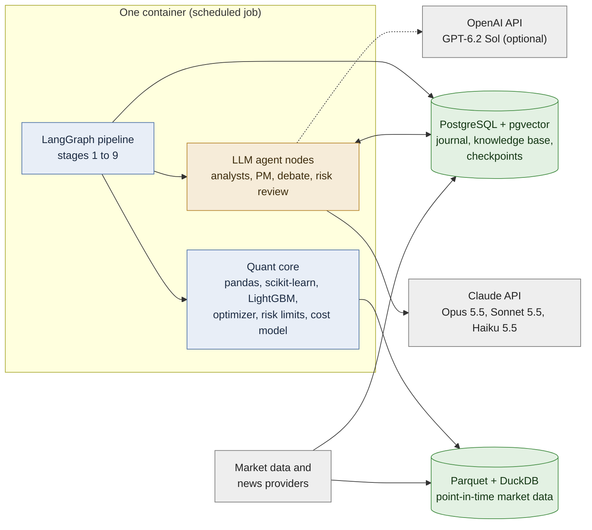

# Technical Architecture

This document picks the technology for the pipeline in [PLAN.md](../PLAN.md): which LLMs the agents use, which agent framework runs them, where the system is deployed and how the agents talk to each other, which programming language it is written in, and which database holds the agents' memory. Each section ends with a recommendation.

Facts about models, prices and SDK versions were checked on 2026-11-19 and are listed under [Sources](#sources). They change quickly, so re-check them before Milestone 3.

## Summary

| Decision | Recommendation |
|----------|----------------|
| LLM | Claude, in three tiers: Opus 5.5 for the portfolio manager, judge and risk review; Sonnet 5.5 for the analysts and debaters; Haiku 5.5 for high-volume classification. One OpenAI model (GPT-6.2 Sol) as an optional second voice in the debate. |
| Agent framework | LangGraph (Python) as the orchestrator, calling Claude through the Anthropic Python SDK. Each agent's instructions are kept as a skill-style Markdown file. Not the Claude Agent SDK and not the OpenAI Agents SDK for the pipeline itself. |
| Deployment and communication | One process, one database. Agents talk through typed, versioned state inside one LangGraph run, not over a network. Run locally with Docker Compose first, then as a scheduled container job on a small cloud host for paper trading. |
| Language | Python 3.12+ for everything now. Java is not recommended for the core; a Java service is a clean later add-on only if a long-running web UI or broker service is wanted. |
| Memory database | PostgreSQL with pgvector: one database for the decision journal (episodic memory), the research knowledge base (semantic memory), and LangGraph checkpoints. Market data stays in Parquet files queried with DuckDB. |

## How the pieces fit

## 1. Which LLM

### What the pipeline needs from a model

- **Reasoning over evidence**: the portfolio manager, the judge and the risk review weigh four reports per ticker and must explain every tilt. These few calls decide the portfolio, so quality matters more than price.
- **Reliable tool use and structured outputs**: every agent returns a typed schema (PLAN.md, "Structured outputs"), and analysts call tools in a ReAct loop.
- **Volume at a low price**: the analysts run per ticker. A short list of 20 tickers means about 60 analyst runs per rebalance, and a five-year weekly backtest replays that about 260 times.
- **Model diversity**: PLAN.md asks for different models where agents disagree (bull versus bear), to reduce correlated reasoning.
- **Point-in-time honesty**: a model knows what happened up to its training cutoff, so LLM-stage backtest results before that date are suspect (PLAN.md, stage 10). This affects every vendor equally.

### Candidates (as of 2026-11-19)

| Model | Vendor | Input / output, $ per 1M tokens | Context | Role it could fill |
|-------|--------|----------------------------------|---------|--------------------|
| Claude Opus 5.5 (`claude-opus-5-5`) | Anthropic | 4 / 20 | 1M | Portfolio manager, judge, risk review |
| Claude Sonnet 5.5 (`claude-sonnet-5-5`) | Anthropic | 2 / 10 | 1M | Analysts, debaters, validator |
| Claude Haiku 5.5 (`claude-haiku-5-5`) | Anthropic | 0.10 / 0.50 (up to 100K-token prompts) | 1M | Headline sentiment, injection screening |
| Claude Fable 5.2 (`claude-fable-5-2`) | Anthropic | 8 / 40 | 1M | Not needed; most capable, but double the Opus price |
| GPT-6.2 Astra (`gpt-6.2-astra`) | OpenAI | 8 / 40 | about 1M | Same tier and price as Fable, not Opus |
| GPT-6.2 Sol (`gpt-6.2-sol`) | OpenAI | 2 / 10 | about 1M | Same price as Sonnet; debate diversity |
| GPT-6 Luna (`gpt-6-luna`) | OpenAI | 0.10 / 0.50 | about 1M | Same price as Haiku |

The two vendors now price their tiers almost identically, so the choice turns on quality, API fit, and tooling rather than cost.

### Pros and cons

**Claude (Opus 5.5 with Sonnet 5.5 and Haiku 5.5)**

Pros:
- Opus 5.5 took first place on the Artificial Analysis Intelligence Index when it launched (58, on v4.3, five points ahead of GPT-6 Astra), with its biggest lead on agentic knowledge-work benchmarks (AA-Briefcase, GDPval-AA). That is the kind of work the manager, judge and risk review do.
- Opus 5.5 costs half of GPT-6.2 Astra per token. OpenAI's cheaper Sol is a Sonnet-class model, not an Opus-class one.
- Both books lean on Claude. baa4f ch. 8 builds the same investment committee with Claude in three tiers (Opus for the portfolio manager and risk officer, Sonnet for three analysts, Haiku for sentiment), so the book code maps across with only model names changed.
- The API has what the pipeline needs: structured outputs (`output_config.format`), strict tool schemas, prompt caching (cache reads at $0.20 per 1M on Opus 5.5), and a Message Batches API at half price, which suits backtest replays.
- Skills (SKILL.md files) are a native Claude concept, which fits the "each role as a skill" idea discussed earlier.

Cons:
- One vendor for the core means one point of failure and correlated reasoning across agents.
- API changes to plan for: on Opus 5.5 thinking cannot be turned off (effort is the control, and its default is `medium`, so set it explicitly); forced `tool_choice` is rejected, so use structured outputs instead; and since API version 2026-10-21 no Claude model accepts `temperature`. PLAN.md's idea of using "different temperatures" for diversity therefore has to become "different models or different prompts".
- Safety classifiers can refuse a request (`stop_reason: "refusal"`). Finance text rarely triggers them, but the harness must handle it, and the server-side fallback option should be on.
- Opus 5.5 spends many reasoning tokens at high effort (about 119K output tokens per Artificial Analysis task), so effort must be tuned per role.

**OpenAI (GPT-6.2 Astra and Sol)**

Pros:
- GPT-6.2 Astra (released 2026-11-17) is strong at finance deliverables by OpenAI's own account: valuation workbooks, investment memos, and trading briefs, plus a lead on GDPval v2.
- GPT-6.2 Sol gives Sonnet-level price with a different training lineage, which is exactly what the debate needs for diversity.
- The OpenAI Agents SDK has tracing and guardrails built in.

Cons:
- The Opus-class role costs twice as much on Astra ($8/$40) as on Opus 5.5 ($4/$20).
- Reported weaknesses: no gain on coding-agent work over GPT-6 Astra, and testers found it sometimes failed to say when a file or tool it needed was missing. A risk pipeline needs agents that report missing data rather than work around it.
- Most of the book code would need porting to OpenAI's API shapes.

Benchmark note: the two indexes quoted here are different versions (Opus 5.5 scored 58 on v4.3 in September; the November report puts Fable 5.2 at 65, GPT-6.2 Astra at 62 and Sol at 57), so they cannot be compared number for number. Public benchmarks do not measure stock analysis. Stage 10's agent evaluation is the real test, and each role's model should be chosen by it.

### Cost estimate per rebalance

Assumptions: 20 tickers on the short list, three per-ticker analysts plus one macro report, about 30K input and 3K output tokens per analyst run including tool results, and about 100K in and 8K out for each of five Opus-tier calls (manager with self-consistency samples, judge, risk review).

| Setup | Analysts (61 runs) | Debate | Opus-tier calls | Total per run |
|-------|-------------------:|-------:|----------------:|--------------:|
| Tiered (recommended) | about $5.50 on Sonnet 5.5 | about $1 on Sonnet 5.5 | about $2.80 on Opus 5.5 | **about $9** |
| All Opus 5.5 | about $11 | about $2 | about $2.80 | about $16 |
| All GPT-6.2 Astra | about $22 | about $4 | about $5.60 | about $32 |

A weekly live run costs about $40 a month on the tiered setup. A full five-year weekly LLM backtest (about 260 runs) costs about $1,200 at batch prices, which is a reason to run the LLM stages in backtests on a sample of dates rather than every date. Prompt caching of the shared analyst reports cuts the debate and risk-review input cost further.

### Recommendation

Use **Claude as the primary vendor, in three tiers**, following baa4f ch. 8:

| Role | Model | Effort |
|------|-------|--------|
| `PortfolioManager`, `Judge`, `RiskOfficer` review | Opus 5.5 | `high` |
| `FundamentalAnalyst`, `TechnicalAnalyst`, `MacroStrategist`, `ReportValidator`, `BullAgent`, `DevilsAdvocate` | Sonnet 5.5 | `medium` |
| `SentimentAnalyst` headline scoring, tool-output injection screening | Haiku 5.5 | `low` |
| `BearAgent` | GPT-6.2 Sol (optional, Milestone 3) | `medium` |

Putting the bear on a different vendor gives the debate genuinely independent reasoning without paying for a second flagship. Keep every model name in config, not in code, so stage 10 can swap a role's model and compare. Turn on refusal fallbacks and set effort explicitly on every call.

## 2. Which agent framework

### What the framework must do

- Run a **fixed, auditable sequence** of stages, with parallel fan-out inside stage 4 and stage 6 (PLAN.md, "How the agents integrate").
- Hold **shared, typed state** that each stage reads and writes, so a stage can be rerun from a saved input.
- **Checkpoint** each step, so a failed run resumes and the person's approval of the trade list can pause a run for hours.
- Work with **more than one model vendor** (Claude plus the optional OpenAI bear).
- Keep LLM agents and deterministic Python code in the **same graph**, because most stages are plain code.

### Options

| Framework | Languages | Model support | Durable state | Fit for this pipeline |
|-----------|-----------|---------------|---------------|-----------------------|
| **LangGraph** 1.2 | Python, TypeScript | Any vendor | Checkpoint per step (Postgres, SQLite); `interrupt()` for human approval | Strong. baa4f ch. 8 builds this exact committee in it. |
| **Claude Agent SDK** 0.2 | Python, TypeScript (other languages via the CLI as a subprocess) | Claude only | Session transcripts, resume and fork; no crash-safe workflow state | Weak for the pipeline, good for coding and research tasks |
| **Claude Managed Agents** (beta) | REST, all Anthropic SDKs including Java | Claude only | Hosted sessions | Weak: built for open-ended agents with a sandbox, billed per session runtime |
| **OpenAI Agents SDK** 0.24 | Python, TypeScript | OpenAI; others via beta adapters | Serializable run state; persistence is up to you | Medium: handoffs and guardrails are good, but it is OpenAI-first |
| **Google ADK** (Python, Java 1.0) | Python, Java, others | Gemini first; others via LangChain4j in Java | Session services | Medium: sequential, parallel and loop agents fit, but Claude is a second-class citizen |
| **Spring AI / Embabel 1.0 / LangChain4j / LangGraph4j** | Java | Many vendors | Varies | Usable, but none of the book code maps across (see section 4) |
| **Plain Anthropic SDK** with your own runner | Any | Claude (add OpenAI SDK for the bear) | Whatever you build | Possible, but you would rebuild checkpoints, fan-out and interrupts |

### Pros and cons of the main three

**LangGraph**
- Pros: explicit nodes and edges match PLAN.md's stage list one to one; the state object is the "shared workspace" of baa4f ch. 8; `Send` gives parallel fan-out for analysts and tickers; Postgres checkpoints give resume and an audit trail; `interrupt()` handles the human approval gate; any model vendor; the most mature of the options (1.0 since October 2025).
- Cons: more code before the first agent runs; LangChain abstractions add a layer between you and the model API; no built-in spend cap (add one in the harness); the best tracing product (LangSmith) is a separate paid service, though OpenTelemetry export works without it.

**Claude Agent SDK**
- Pros: Claude Code's harness as a library: built-in file, shell and web tools, subagents, skills, hooks, permissions, and a dollar budget cap that includes subagents. Skills are first class.
- Cons: Claude only; it drives the Claude Code binary as a subprocess, so each agent is a heavyweight process; its built-in tools (file edit, shell) are a liability for a trading pipeline whose agents should only call a fixed set of read-only data tools; no durable workflow state for a multi-stage run. It is built for open-ended agents, while this pipeline is a fixed workflow with LLM steps.

**OpenAI Agents SDK**
- Pros: small API (agents, tools, handoffs, guardrails); tracing on by default; resumable approval pauses.
- Cons: OpenAI-first, with non-OpenAI models through adapters its docs call best-effort; traces go to OpenAI unless reconfigured; handoffs suit conversational routing more than a fixed sequence.

### Where skills fit

The earlier suggestion was to write each analyst role as a Claude Skill run inside subagents. The useful part of that idea is keeping each role's instructions, output format and examples in one versioned Markdown file. The orchestration part does not need the Claude Agent SDK:

- Store each role as `agents/<role>/SKILL.md` (front matter with name, description, model and effort; body with the instructions). A LangGraph node loads it as the system prompt. This gives PLAN.md's "versioned prompt file" per agent.
- The same files can be loaded by Claude Code during development, so you can try a role interactively before wiring it into the graph.
- The debate's separate contexts come for free: each LangGraph node makes its own model call with its own messages, so the bull never sees the bear's reasoning.
- Risk limits, sizing and backtests stay as plain Python functions called by graph nodes, so no LLM can talk its way past them.

### Recommendation

Use **LangGraph** as the orchestrator, with **Pydantic** models for every stage input and output, the **Anthropic Python SDK** for Claude calls (through `langchain-anthropic` or directly inside nodes), and the **OpenAI Python SDK** only for the optional bear. Keep each role's prompt in a skill-style `SKILL.md`. Use the Claude Agent SDK and Claude Code as development tools (research, writing stage notes, generating tests), not as the runtime.

Guard against lock-in by keeping LangGraph at the edge: each stage is a plain function `run(inputs: StageInput) -> StageOutput`, and the graph only wires them together. Swapping LangGraph out later would mean rewriting the wiring, not the stages.

## 3. Deployment and inter-agent communication

### Workload shape

- One user, one portfolio.
- A **batch job**: stages 1 to 9 run once per rebalance date (weekly or monthly), take minutes, and end with a trade list for the person to review.
- **Backtests** (stage 10) are long offline jobs on a workstation.
- **Monitoring** (stage 11) needs a small daily job.
- No order placement: the person places trades (PLAN.md, stage 9).

Nothing here needs a service that is always on, a message bus, or agents on separate machines.

### How agents communicate

| Option | Pros | Cons |
|--------|------|------|
| **In-process typed state** (LangGraph state with Pydantic models) | Simple; every hand-off is a typed object; whole run is one transaction in the journal; easy to replay a stage from saved input; no network failures between agents | All agents share one process and language |
| Message queue (Redis Streams, RabbitMQ, Kafka) | Decouples stages; agents could scale independently | Extra infrastructure; harder replay and tracing; buys nothing for a weekly batch job |
| Agent-to-agent protocol (A2A) between services | Agents can be built and deployed by different teams in different languages | Built for agents across organizations; heavy for one person's pipeline |
| MCP servers for tools | Tools can be reused by Claude Code, the pipeline, and any other client | Adds a process per tool server |

Communication rules:

- Agents never call each other. The graph passes each stage's output to the next stage, as PLAN.md requires.
- Every stage output is a versioned Pydantic model, written to the journal as JSON when the stage finishes. That gives replay (load the saved input, rerun one stage) and the audit trail.
- `AnalystReports` is written once and is read-only afterwards, enforced by making the model immutable (`frozen=True`).
- Parallel work (four analysts, many tickers, bull and bear) uses LangGraph's fan-out inside the same run, bounded by a concurrency limit for API rate limits.
- Data tools (prices, fundamentals, filings search) are plain Python functions with a shared cache. Wrap them as MCP servers later only if you want Claude Code to use the same tools during research.

### Where to deploy

| Phase | Where | What runs |
|-------|-------|-----------|
| Milestones 0 to 3 | Your machine, with Docker Compose | Postgres + pgvector container; the pipeline as a CLI (`uv run pipeline run --date ...`); backtests locally |
| Milestone 4 (paper trading) | One small cloud host or a managed scheduled container job (for example a $10 to $20 a month VM, or a scheduled container job on AWS, Google Cloud or Fly.io) with a managed Postgres | The same container image on a cron schedule, plus a daily monitoring job; results e-mailed or posted as a report |
| Later, if wanted | Same host | A small read-only web dashboard over the journal |

Secrets (Claude and OpenAI API keys, data provider keys) live in environment variables from the host's secret store, never in the repository. Tracing goes to OpenTelemetry, viewable locally with a free collector such as Jaeger or Grafana, or in LangSmith if you choose to pay for it.

### Recommendation

Run the pipeline as **one containerized batch job** with **in-process, typed communication** through LangGraph state and a **Postgres journal**. Develop locally with Docker Compose; move the same image to a scheduled job on a small cloud host for Milestone 4. Do not add a message queue, A2A, or separate agent services; add them only if the pipeline ever needs to run continuously or serve other users.

## 4. Programming language

### Where the book code is

- **ml4t** is Python throughout, built on libraries such as pandas and Polars, scikit-learn, LightGBM, DuckDB, and deep learning and portfolio libraries. Stages 1, 2, 3, 5 (optimizer), 8 (risk limits), 9 and 10 all come from this side.
- **baa4f** code is Python: LangGraph, `langchain-anthropic`, `langchain-openai`, yfinance. Chapter 8, the closest match to this pipeline, is a LangGraph program.

Most of the pipeline's code is quantitative, and all of the reference code for it is Python.

### Java versus Python

| | Python | Java |
|--|--------|------|
| ML and quant libraries | Native: pandas, Polars, scikit-learn, LightGBM, PyTorch, statsmodels, SHAP, cvxpy, PyPortfolioOpt, riskfolio-lib | Thin: Tribuo, Smile, DJL, XGBoost4J and LightGBM JNI bindings; no pandas equivalent, no SHAP, few portfolio optimizers |
| Reuse of book code | Copy the patterns and adapt | Rewrite every example |
| Agent frameworks | LangGraph, Claude Agent SDK, OpenAI Agents SDK, PydanticAI: all first-class | Spring AI, Embabel 1.0 (August 2026), LangChain4j, Google ADK Java 1.0, LangGraph4j: usable, younger, smaller communities |
| LLM vendor SDKs | Official Anthropic and OpenAI SDKs | Official Anthropic and OpenAI Java SDKs exist and are good |
| Claude Agent SDK | Yes | No (only by running the CLI as a subprocess) |
| Typing and refactoring | Optional typing (Pydantic, pyright) | Strong static typing, records, sealed interfaces; better IDE refactoring |
| Performance | Fast where it matters (NumPy, Polars, LightGBM are C/C++/Rust); the slow parts are LLM calls, which language does not change | Faster plain loops, good concurrency; not a bottleneck here |
| Notebooks and research | Jupyter, the normal tool for factor research | Possible (JShell, Jupyter Java kernels) but rare |
| Your familiarity | Lower, from what you said | Higher; you prefer it |

### The split option: Python quant core plus Java services

A split puts the data, models, optimizer and backtester in Python and puts the agents or the orchestration in Java (for example Spring AI or Embabel), talking over REST or gRPC.

Pros:
- You write the orchestration and agent code in the language you prefer.
- Java's type system is a good fit for the strict stage schemas.

Cons:
- Two toolchains, two test suites, two dependency managers and two deploy units for a one-person project.
- Every stage schema must exist in both languages and stay in sync (Pydantic plus Java records, kept aligned with JSON Schema code generation).
- The agent layer is the part that maps most directly to baa4f's Python code, and it would be the part rewritten.
- A network boundary inside a weekly batch job adds failure modes without adding anything the job needs.
- LLM look-ahead and backtest replay (stage 10) must run the agents and the quant code together over history, which is simplest in one process.

The split pays off only when there is a long-running service with real users, which this project does not have yet.

### Recommendation

Use **Python for the whole pipeline**: Python 3.12 or later, `uv` for dependencies, `ruff` for lint and format, `pyright` in strict mode for type checks, and `pytest` for tests. Strict typing with Pydantic and pyright recovers much of what Java's type system gives.

If you want Java in the project, the clean place for it is **Milestone 4 or later**: a read-only Spring Boot dashboard or API over the Postgres journal, or a broker integration service. It reads stage outputs as JSON (with Java records generated from the Pydantic JSON Schemas), so the Python core does not change. Decide this at Milestone 4, not now.

## 5. Database for episodic and semantic memory

### What has to be stored

| Store | Contents | Access pattern | Written by |
|-------|----------|----------------|------------|
| **Episodic memory**: the decision journal | Every stage's input and output per run, model and prompt versions, token cost, timestamps; past regime calls and past proposals with their outcomes | Append-only; read by run date, ticker and stage; joined with later returns | The pipeline runner (stage 11) |
| **Semantic memory**: the research knowledge base | Chunks of filings, transcripts and news with embeddings and metadata (ticker, filing type, fiscal period, publication time); facts found in earlier runs | Hybrid search (vector similarity plus keywords) with filters on ticker, date and document type | Ingest jobs; analysts (stage 4) |
| **Workflow state** | LangGraph checkpoints | Key-value by run and step | LangGraph |
| **Market data** | Point-in-time prices and fundamentals | Large columnar scans | Stage 1 |

Every memory row carries the time it became known (`known_at`). During a backtest replay for date D, retrieval must only return rows with `known_at <= D`. Without that filter, the memory leaks the future into the backtest, the same leakage PLAN.md guards against in the alpha models.

### Options

| Option | Pros | Cons |
|--------|------|------|
| **PostgreSQL + pgvector** | One database for journal, vectors and checkpoints; SQL joins between memories and outcomes; one transaction writes a document and its embedding; time filters are plain `WHERE` clauses; LangGraph has a Postgres checkpointer; handles millions of vectors on one instance; free and runs anywhere | Built-in keyword search is basic (Postgres full-text, not BM25) unless you add an extension such as ParadeDB `pg_search`; slower than dedicated vector stores past tens of millions of vectors |
| **Qdrant** | Fast vector search, payload filters, quantization, native hybrid search | A second store for the journal is still needed; no joins; two stores to keep in sync |
| **ChromaDB** | Easiest for prototypes; used in baa4f examples | Not a journal; weaker filtering and operations story; ml4t ch. 22 recommends it only for prototypes |
| **LanceDB / DuckDB** | Embedded, file-based, columnar; good for offline analysis | Weak concurrent writes; less suited to an operational journal |
| **Pinecone / Weaviate Cloud** | Managed, hybrid search built in | Paid service and a second store; data leaves your control |
| **Neo4j** (knowledge graph, ml4t ch. 23) | Relationships between companies, suppliers and people | Not needed until a knowledge-graph feature earns its place |
| **Memory services** (Mem0, Zep) | Ready-made episodic and semantic memory APIs | Built for chat-assistant memory; less control over point-in-time filtering and the audit trail |

The corpus is small for one person's universe: even 1,000 companies with five years of filings, transcripts and news is a few million chunks, well within pgvector's range.

### Recommendation

Use **PostgreSQL 17 with pgvector** as the single memory database:

- `journal_*` tables (append-only, JSONB payloads plus indexed columns for run date, stage, ticker) for episodic memory. The application role gets `INSERT` and `SELECT` only, so no agent can rewrite history.
- `kb_chunks` (text, embedding, ticker, document type, fiscal period, `known_at`, source URL) for semantic memory, with an HNSW vector index and Postgres full-text search for hybrid retrieval. Add ParadeDB `pg_search` if evaluation shows BM25 matters.
- LangGraph's Postgres checkpointer in the same database.
- Embeddings from a dedicated embedding model (Claude does not provide one): start with OpenAI `text-embedding-3-small` as in baa4f ch. 10, or a finance-tuned model such as Voyage's, and choose by retrieval evaluation on your own corpus as ml4t ch. 22 advises. Store the embedding model's name with each row so a model change can trigger re-embedding.

Keep **market data in Parquet files queried with DuckDB or Polars**, outside Postgres, since columnar scans over price history are what those tools are built for.

## Resulting stack

| Layer | Choice |
|-------|--------|
| Language | Python 3.12+ |
| Tooling | `uv`, `ruff`, `pyright` (strict), `pytest` |
| Schemas | Pydantic v2, versioned, frozen where read-only |
| Orchestration | LangGraph with the Postgres checkpointer |
| LLM SDKs | `anthropic` (and `langchain-anthropic`), `openai` for the optional bear |
| Models | Opus 5.5, Sonnet 5.5, Haiku 5.5; GPT-6.2 Sol optional |
| Agent prompts | `agents/<role>/SKILL.md`, versioned |
| Quant | pandas or Polars, NumPy, scikit-learn, LightGBM, statsmodels, an optimizer library (cvxpy or riskfolio-lib) |
| Market data store | Parquet + DuckDB |
| Memory store | PostgreSQL 17 + pgvector |
| Tracing | OpenTelemetry (LangSmith optional) |
| Runtime | Docker Compose locally; one scheduled container job in the cloud for Milestone 4 |

These choices fill in the Milestone 1 item "Choose the language, dependency manager, test runner and linter". Once agreed, record the commands in CLAUDE.md.

## Open questions for you

- Market data and news provider (free sources such as yfinance and SEC EDGAR, or a paid point-in-time provider). This decides how good the backtests can be.
- Rebalance frequency (weekly or monthly), which sets the monthly LLM cost.
- Whether you want the Java dashboard at Milestone 4.

## Sources

Checked 2026-11-19.

- Claude model IDs, prices and API behavior: Anthropic model and API documentation (via the Claude API reference), [Agent SDK overview](https://code.claude.com/docs/en/agent-sdk/overview.md), [Anthropic Java SDK](https://platform.claude.com/docs/en/cli-sdks-libraries/sdks/java)
- [Claude Opus 5.5 takes the top spot on Artificial Analysis at 58](https://rits.shanghai.nyu.edu/ai/claude-opus-5-5-takes-the-top-spot-on-artificial-analysis-at-58/)
- [Introducing GPT-6.2 Astra and Sol (OpenAI)](https://openai.com/index/introducing-gpt-6-2-astra-sol)
- [OpenAI's GPT-6.2 Astra challenges Anthropic on price, but not every benchmark (Decrypt)](https://decrypt.co/383488/openai-gpt-6-2-astra-challenges-anthropic-price-but-not-every-benchmark)
- [OpenAI API pricing (BenchLM, November 2026)](https://benchlm.ai/openai/api-pricing)
- [Claude Agent SDK vs OpenAI Agents SDK vs LangGraph](https://wetheflywheel.com/en/comparisons/claude-agent-sdk-vs-openai-agents-sdk-vs-langgraph/)
- [Top Gen AI frameworks for Java in 2026](https://dev.to/gde/top-gen-ai-frameworks-for-java-in-2026-a-hands-on-comparison-3e29)
- [Embabel 1.0 (InfoQ, August 2026)](https://infoq.com/news/2026/08/embabel-1)
- [Announcing ADK for Java 1.0.0](https://developers.googleblog.com/en/announcing-adk-for-java-100-building-the-future-of-ai-agents-in-java/)
- [pgvector vs Qdrant (Encore)](https://encore.dev/resources/pgvector-vs-qdrant)
- Local copies of the books: baa4f ch. 3 (framework comparison), ch. 8 (LangGraph committee with Opus, Sonnet and Haiku per role), ch. 10 (agentic RAG); ml4t ch. 22 (vector database selection, hybrid retrieval)
